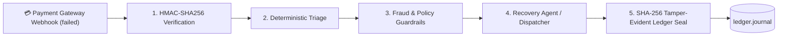

# SurakshaPay 🛡️
> **Autonomous FinTech Payment Failure Recovery & Cryptographic Audit Ledger**

SurakshaPay is a high-resilience payment failure recovery engine designed for high-volume merchant platforms. It intercepts failed transaction webhooks, performs HMAC-SHA256 signature verification, runs deterministic triage and fraud guardrails, and seals every recovery event into an immutable, SHA-256 tamper-evident cryptographic audit ledger.

---

## ⚡ Key Architecture & Features



### 1. Cryptographic Security & HMAC Verification
* **Webhook Authentication:** Verifies inbound payment events with `HMAC-SHA256` signatures against merchant secrets to eliminate spoofing and replay attacks.
* **Tamper-Evident Ledger (`ledger.py`):** Implements cryptographic hash chaining (`sha256(prev_hash + canonical_payload)`) ensuring full mathematical proof of immutability and state durability upon system boot.

### 2. Automated 5-Stage Recovery Pipeline
1. **Stage 1 — Webhook Ingestion:** Asynchronous ingestion of `payment.failed` payloads.
2. **Stage 2 — Deterministic Triage:** Categorizes failures (insufficient funds, bank downtime, authentication failure, network timeout).
3. **Stage 3 — Guardrails Enforcement:** Applies TRAI regulations, customer touch limits, and velocity caps to prevent spam or fraud loops.
4. **Stage 4 — Intelligent Recovery Agent:** Dynamically formats context-aware recovery links and templates with automatic fallback.
5. **Stage 5 — Hash Chain Sealing:** Appends verified transaction states to `ledger.journal`.

---

## 🛠️ Tech Stack
* **Backend:** Python 3.11+, FastAPI (Async), Pydantic v2, Uvicorn, HTTPX
* **Security & Cryptography:** HMAC-SHA256, Hashlib, Cryptographic Chaining
* **Frontend:** React 18, Vite, Tailwind CSS, GSAP, Lenis Smooth Scroll
* **Persistence & Durability:** Append-only cryptographic journal (`ledger.journal`), SQLite

---

## 🚀 Quickstart & Local Setup

### 1. Backend Setup
```bash
cd backend
python -m venv venv
# Windows:
venv\Scripts\activate
# Linux/macOS:
source venv/bin/activate

pip install -r requirements.txt
uvicorn backend.main:app --reload --port 8000
```

### 2. Frontend Setup
```bash
npm install
npm run dev
```

The web dashboard will be accessible at `http://localhost:5173` and Swagger API docs at `http://localhost:8000/docs`.

---

## 🔒 Verification & Ledger Integrity
Run the built-in cryptographic audit verification:
```python
from backend.ledger import verify, head
# Validates complete genesis-to-head hash continuity
is_valid = verify(ledger_chain)
print("Ledger Tamper Status:", "INTEGRITY_VERIFIED" if is_valid else "TAMPER_DETECTED")
```

---

## 📄 License
MIT License. Built for resilient payments infrastructure.
